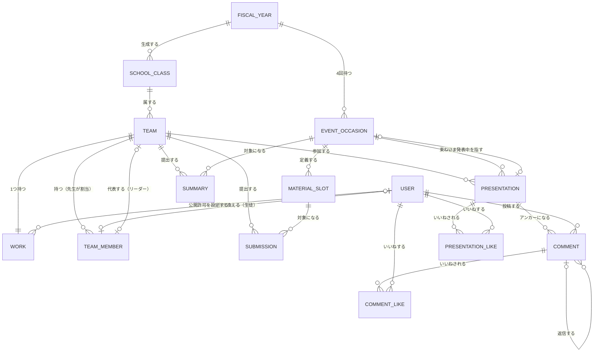
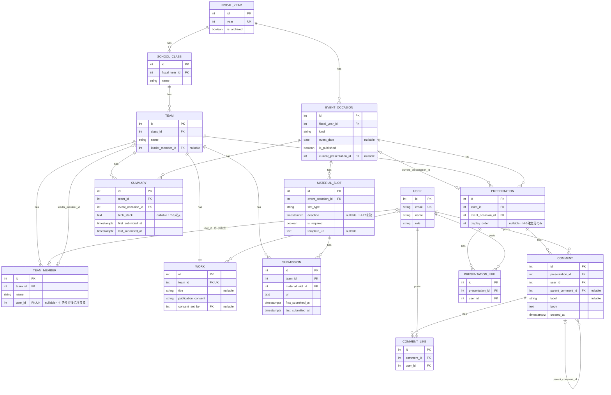

# 06. データ設計

> **位置づけ**：語彙をどうテーブルへ落とすか — ER・テーブル定義・コード定義を答える
> **確度**：**暫定（レビュー未了）。ただし、下の「確定の範囲」に挙げた部分だけ確定**
> **正典**：このファイル（テーブル定義の正典。**語彙の正典は `../glossary.md`**）
> **更新のしかた**：上書き
> **主担当**：蒲山
> **最終更新**：2026-10-23（水戸）

> [!note] 確定の範囲（2026-10-19・10-20 のレビュー対象）
> **確定するのは次の部分だけ**（`../../AGENTS.md` 禁則7 の「確定の範囲」）。範囲の外は暫定のままで、決定の根拠として引用しない（禁則6）。
> - **対象**：6-3 の全 14 テーブルの列定義（列名・型・NULL・既定値・制約・対応する語彙・根拠、表の下の注。ただし注のうち、共通②で外れる文を除く）と、6-1・6-2 の ER 図。10/19 に基盤・背骨の 10 テーブル（`fiscal_years`・`classes`・`teams`・`team_members`・`works`・`users`・`event_occasions`・`material_slots`・`submissions`・`summaries`）、10/20 に後段の 4 テーブル（`presentations`・`comments`・`presentation_likes`・`comment_likes`）と ER 図
> - **対象の中でも、確定に含めない列・記述**（未決に依存するため。ER 図は、下の列に当たる属性と、その列が表す関連のカーディナリティ〔6-1・6-2 の `SCHOOL_CLASS`–`TEAM` のクラス側＝`teams.class_id` の NOT NULL、`USER`–`TEAM_MEMBER` のメンバー行の側＝`team_members.user_id` の UNIQUE が全年度に効く形〕を、同じ列に付いた未決の注記とあわせて確定に含めない）：
>   - `users`：確定に含めるのは `id`・`role` だけ。ただし `id` の型（`serial`）は含めない（H-30 ④。Auth.js の Prisma Adapter を採ると、利用者の id を文字列で渡すため、型が変わりうる。`users.id` を参照する外部キーの列〔`team_members.user_id`・`works.consent_set_by`・`comments.user_id`・`presentation_likes.user_id`・`comment_likes.user_id`〕の型も連動するので、同じく含めない）。`email`（利用者の同一性のキー・H-32）と `name`（先生の事前登録とホワイトリストの実体・H-26）は含めない
>   - `works`：`consent_set_by` の型（H-30 ④。`users.id` の型に連動する）。NULL 可・外部キー・CHECK は含める
>   - `fiscal_years`：未アーカイブの年度を同時に 1 件に限る制約の有無（H-54 の判断①）
>   - `team_members`・`teams`：`name` の長さの上限（`varchar` の型）と、`team_members.name` の同姓同名を禁じる制約の有無（H-56）
>   - `teams`：`class_id` の NULL 可否（H-46。「チームがクラスに属さない状態を許す」案の決着で変わる）
>   - `team_members`：`user_id` の UNIQUE が効く範囲（全年度に効く。年度をまたいだ引き換えの扱い・H-25 (d)(e)。本文が「本節では決めない」としている部分）。`user_id` の NULL 可・外部キーは含める（型は、上の `users` の行のとおり H-30 ④で含めない）
>   - `material_slots`：`deadline` の NULL 可否・既定値（H-27）。型 `timestamptz` は H-39 の決着（`../decisions.md` 2026-10-20）に従うが、確定の範囲を広げる判断はこの変更では行わない（レビューを経る）
>   - `submissions`：`url`（Drive 統合の範囲・未決 No.10。リンクの形が変わる）。`first_submitted_at`・`last_submitted_at` の型 `timestamptz` は H-39 の決着に従うが、範囲は広げない（同上）
>   - `summaries`：`tech_stack` の型（T-3）。`first_submitted_at`・`last_submitted_at` の型 `timestamptz` は H-39 の決着に従うが、範囲は広げない（同上）
>   - `presentations`：時刻枠（開始時刻・所要・休憩）を列として持たない前提（H-20）、表の下の「行の生成タイミング」の注（H-46 の決着で見直す。「クラスに属さないチームを許す」案を採ると、「そのチームの年度に」が `team → class → fiscal_year` で引けなくなる）
>   - `comments`：編集・削除の列を持たない前提（T-2）。`created_at` の型 `timestamptz` と既定値 `now()` は H-39 の決着に従うが、範囲は広げない（同上）
> - **確定に含めないもの（共通）**：①列・テーブル・関連の集合の完全さ（確定するのは挙げた列の定義で、挙げていない列・テーブル・関連が無いことまでは保証しない。たとえば H-20 の「タイムテーブルの行」の実体が ER 図に無いことは保証しない）。**ER 図は 6-3 から描いたもので、図に無い制約は 6-3 が正**（複合の UNIQUE、複合外部キーが複合であること〔`teams.leader_member_id`・`event_occasions.current_presentation_id`〕は図に描いていない）　②各テーブルの表の下の注のうち、範囲外の節や未決を指す文　③上流が TODO の根拠：`teams`・`team_members`・`users` の上流（`../requirements.md` §3-8・§3-6）は、できること・受け入れ基準が TODO のまま。この 3 テーブルの根拠は `../glossary.md` と `../decisions.md` に限られ、上流が埋まったとき、確定した列が変わりうる。特に `users.role` の 2 値は、先生ロールの親子二層構造（#8。先行方針は「単層で組む」）を採るときに、値を増やすか別の列で持つかが決まっていない
> - **範囲外の節**：6-4〜6-7（索引方針の 6-5 を含む）、参照動作（コメントを参照する外部キーの動作が T-2 に依存する）
> - **レビューする論点**：①各列が `../glossary.md`・`../requirements.md` のどの記述に対応するか（根拠の欄）が足りているか　②外部キーの向きと UNIQUE が、語彙の関係（チーム・メンバー・リーダー、資料枠・提出、発表・コメント・いいね）と合っているか　③NULL 可否が運用（先生がチームを作る・年度セットアップが資料枠を生成する）と合っているか　④型・既定値・CHECK が、正典の記述（`../glossary.md`・`../requirements.md`・`../decisions.md`）と合っているか。⑤6-1・6-2 の ER 図が 6-3 と一致し、関連の名前が正典と合っているか（#124。6-1 は属性を持たず、関連の名前とカーディナリティを持つ図なので、6-2 と照らすだけでなく、関連の名前の出典も見る）　⑥未決の先行方針の見直し（#124。H-20・H-26・H-27・H-32・T-2。結論は下の欄に書く）
> - **結論**
>   - **10/19 分**（2026-10-20）：範囲の 10 テーブルについて、論点①〜④とも水戸の確認を終えた（①〜③は各スレッド、④は R-2 のスレッド）。①根拠の欄：出典が無かった列（`fiscal_years.year`・`teams.class_id`・`material_slots.event_occasion_id`・`submissions.team_id`）と、`teams.name` の一意の範囲の根拠を足した。根拠が古い列は無かった。②外部キーの向き：10 テーブルとも語彙の関係と合う。`event_occasions` の `UNIQUE(fiscal_year_id, kind)` を張らない理由と、アプリ層で守る組み合わせは、注に書いた。③NULL 可否：`teams.class_id` は H-46 に乗るので確定から外した。ほかは運用と合う。④型・既定値・CHECK：既定値 4 件と CHECK は正典に裏づけがある。未決に依存する列は、上の「確定に含めない列・記述」のとおり含めない。**列の集合の完全さと、未決の決着は保証しない。**
>   - **10/20 分**（2026-10-20）：後段の 4 テーブル（`presentations`・`comments`・`presentation_likes`・`comment_likes`）と 6-1・6-2 の ER 図について、論点①〜⑥とも水戸の確認を終えた（①〜③・⑤・⑥は各スレッド、④は #124 の R-1 のスレッド）。鈴木は①〜③、⑤のうち後段 4 テーブルの 6-2 と 6-3 の一致、⑥を見た。①根拠の欄：`comments.body`・`created_at`、いいねの `user_id` の根拠と、いいねの対応する語彙を足した。②外部キーの向きと UNIQUE：語彙の関係と合う。いいねの 1 人 1 回は「06 の設計判断」と明記し、返信の親が同じ発表に属することはアプリ層で守る（注に書いた）。③NULL 可否：`display_order`・`parent_comment_id` が NULL 可なのは運用と合う。`comments.label` のラベルなしを許す点は「06 の設計判断」と明記した。④型・既定値・CHECK：`label` の 3 値の CHECK は `../requirements.md` §3-9 と合う。⑤6-1・6-2 の ER 図：関連は 23 本ずつで線ごとに対応し、関連の名前も正典に裏づけがある。6-2 の属性・主キー・外部キー・カーディナリティは 6-3 と一致し、型の表記をそろえた。ただし、13 行で外した 2 か所を除く。アプリ層の規則で成り立つ線は、6-3 の注が正。⑥H-20・H-26・H-27・H-32・T-2 の 5 件とも決着を待ち、確定に含めない（先行方針で実装を進めることはできる）。H-46 は、上の一覧のとおり外したまま。**列・テーブル・関連の集合の完全さと、未決の決着は保証しない。**

## この章が答える問い

`../glossary.md` が「この言葉は何を指すか」に答えるのに対し、この章は「**それをどう格納するか**」に答える。**別の問いなので、両方が正典として並存する。**

> **`../glossary.md` の定義を転記しない。** 各テーブルに「対応する語彙：`../glossary.md` §4 提出」と書き、定義本体は参照で済ませる（`00-conventions.md` §4-1）。

## 書くもの

| # | 成果物 | 形式 |
| --- | --- | --- |
| 6-1 | 概念 ER 図 | 図（エンティティと関連のみ。属性は載せない） |
| 6-2 | 論理 ER 図 | 図（属性・主キー・外部キー・カーディナリティ） |
| 6-3 | テーブル定義 | テーブルごとに：列名 ／ 型 ／ NULL ／ 既定値 ／ 制約 ／ **対応する語彙** ／ **根拠（決定日）** |
| 6-4 | コード定義 | 表（クラス ／ 回種別 ／ 資料枠種類 ／ ロール ／ コメントラベル ／ 公開許可状態 の列挙値と、その出典） |
| 6-5 | インデックス方針 | 検索・提出状況一覧の想定クエリに対する設計 |
| 6-6 | 導出値の一覧 | **テーブルに持たない値**（提出状態・遅延・提出率など）と、その導出式 |
| 6-7 | Prisma スキーマへの落とし込み | 6-3 から機械的に導出できない項目の一覧（Ph.2 で手書き SQL が要るもの） |

> **6-6 を必ず置く。** 「遅延は状態ではなく導出値」（`../glossary.md` §4）のような決定が、列として実装されるのを防ぐ。

## 書かないもの

| 書かないこと | 参照先 |
| --- | --- |
| 語の定義・粒度・アンカー | `../glossary.md` |
| 決定の根拠の全文 | `../decisions.md` |
| 物理設計（パーティション・チューニング） | 詳細設計の範囲 |

## 埋まる条件

**着手可能。ただし障害は依然として最も多く、かつ本設計書のクリティカルパス。**

### 先に解く必要があった正典の矛盾 — 2026-09-04 決着

**A-1（発表順の所属）・A-3（概要の粒度）は `../decisions.md` へ記録して決着済み。** 発表順は発表エンティティの整数属性、概要は発表（チーム×発表会）にひもづく年4件。**ER の形を縛る矛盾は解消し、本章は着手可能になった**（#7 等の ER 直結未決は下表に残る）。

**2026-09-04 追加決着 — ER の形が確定した箇所**（`../decisions.md` 同日）

- **クラス**：年度セットアップで生成する**運用データ**。登録主体は先生。**クラス名は分解せず文字列 1 つ**で持つ（学科・学年・組へ分解することを要求する要件が正典に無い）。命名は「学科＋学年＋組」＝ `IG21` は IG 科 2 年 1 組（H-3 決着）
- **チーム**：**先生（担任）が作成する。生徒はチームを作成できない**（#6 決着）
- **リーダー**：**チームの属性**（代表者 1 名への参照）であって**ロールではない**。ロールが DB で持つ値は「先生／生徒」の 2 値のまま。責務は公開許可の設定のみ
- **年度セットアップとチーム登録**：**独立した操作**で順序を強制しない。チーム 0 件のときの提出状況一覧は空状態（H-9 決着）

### ER 直結の未決

| 障害 | 内容 | 先行方針 |
| --- | --- | --- |
| **#7** | テンプレートの扱い | — |
| **#8** | 先生ロールの親子二層構造の要否 | 単層で組む |
| **#10** | Drive 統合の範囲（提出のリンク列の形が変わる） | Stage 1＝リンク登録 |
| **T-3** | 使用技術欄の表記ゆれ（自由記述か統制語彙か） | — |
| **H-20**（新規・2026-09-11 起票） | 当日タイムテーブルの「時刻枠」の中身（開始時刻・所要・休憩）が未定義 | 発表エンティティは発表順（整数）のみを持つ。時刻枠の列は追加しない |
| **H-26**（新規・2026-09-21 起票） | 先生の事前登録をメールのみで許すか、初回サインイン後の昇格のみか（`users.name NOT NULL` との関係） | `users` は現行の定義のまま、初回サインイン後の昇格のみが成立する形で組む |
| **H-27**（新規・2026-09-21 起票） | 年度セットアップ時点で資料枠の締切が決まっているか（`material_slots.deadline` の NULL 可否） | NULL 可で組む。未設定の枠は遅延判定の対象外 |
| **H-30**（2026-09-21 起票） | セッション戦略（JWT／Prisma Adapter）。Adapter を採ると、公式の Adapter は文字列の id を `where` に渡すので、整数の `users.id` のままでは使えない。`users.id` と、それを参照する外部キーの列の型、または Auth.js の `User`／`Account`／`Session` テーブルが ER に影響する（`../open-questions.md` H-30） | Adapter なし・JWT 戦略で組む。`users.id` は整数のまま |

> **H-6 は 2026-09-29 に決着した**（`../decisions.md`）。

### 既存モック実装との差（2026-09-03 監査）

**`src/lib/types.ts` は「モック画面用の仮スキーマ」であり、この章の下書きではない。** 2026-09-03 の監査で乖離が確認され、**クラス・資料（概要以外）の提出日時・定番の資料枠の組はその後モック側が正典に寄った**（下表は現状）。ER を引くときに引きずらないこと。

| 項目 | 正典 | モック実装 |
| --- | --- | --- |
| クラス | AI21 / BD21 / GS21 / IG21 / IG22 | IG21／IG22 の 2 つだけ（正典の 5 つの部分集合。AI21・BD21・GS21 は出てこない） |
| 定番の資料枠 | `../requirements.md` §3-1「定番の資料枠」（2026-10-09 に 2 枠へ改めた） | プレゼン資料＋概要の 2 枠で、枠の組も枠名も一致 |
| 提出日時 | 初回提出日時・最終更新日時の 2 値（概要枠を含む。決着・2026-09-29） | 資料（`Material`）は `firstSubmittedAt`／`updatedAt` の 2 値で一致。概要（`SummaryEntry`）は `submittedAt` の 1 値で、提出のたびに上書きする（画面の表示は「最終提出」） |
| 概要枠の持ち方 | 概要枠だけが独立エンティティ（概要）で、他の資料枠はリンク登録の資料（H-2・`../decisions.md` 2026-09-04。粒度は A-3） | 概要枠を `Material`（「概要」）と `SummaryEntry` の 2 か所に持ち、同じ概要の日時が食い違う（`submissions.ts` の Cheers・企画） |
| 締切 | **資料枠**の属性（確定・2026-07-26） | 発表会に 1 つだけ |
| 発表順 | 発表エンティティの整数属性 | タイムテーブル行にのみ存在 |
| 正典に無い属性 | — | 発表会の3値ステータス／Template エンティティと形式区分／Team.summary／Material.driveUrl |

> **訂正**：上表はモック実装の「公開許可の『拒否』」を正典に無い属性と分類していたが、これは誤り。`../requirements.md` §3-7 受け入れ基準に「公開許可が**未設定・拒否**の作品は…表示されない」と明記されており、「拒否」は正典に実在する語である（H-22 決着・`../decisions.md` 2026-09-11）。

## 現在の状態

**初稿。** 正典から直接読めない箇所は、未決 H-20・H-26・H-27 として `../open-questions.md` に起票し、先行方針（同 §7）で組んだ。**冒頭の「確定の範囲」を除いて、確度「暫定」でレビュー未了**（`../../AGENTS.md` 禁則6）— 範囲の外は、他章から「決定」として引用しないこと。

> **2026-09-28 更新：H-29（所属はメンバー行）と `decisions.md` 2026-09-22の行（リーダーの参照先はメンバー行）を ER・テーブル定義へ反映した。** `team_members`（メンバー）テーブルを新設し、`users.team_id` は廃止、`teams.leader_user_id` は `teams.leader_member_id` へ改名して `team_members` を参照する形にした（6-2・6-3）。`09-nfr.md` が文脈判定を「06 待ち」と書いているのはこの箇所で、これで実行主体側の所属の取り方（`team_members.user_id` からの逆引き）が定まった。

**この章が開くと 03・04・05・07 が一斉に開く**（`00-conventions.md` §5-4）。逆に言えば、ここを開けない限り設計書は完成しない。

---

## 6-1. 概念 ER 図

エンティティと関連のみ。属性は載せない（`../glossary.md` の粒度定義に対応）。

> **「発表」は「チーム×発表会」の安定エンティティ**（`../glossary.md` §4）。コメント・いいね・発表順はここにぶら下がる。
> **「提出」と「概要」は別エンティティ**（H-2・A-3 決着）。概要枠はフォーム入力で内容そのものを保持し、他の資料枠はリンク登録として「提出」に集約する。
> **`SCHOOL_CLASS` は Mermaid の描画都合による表記**（`CLASS` が erDiagram の予約語と衝突するための改名）。**実テーブル名は `classes`**（6-3）。

---

## 6-2. 論理 ER 図

属性・主キー・外部キー・カーディナリティ。**H-20 が未決のため、発表（PRESENTATION）は発表順のみを持ち、時刻枠の列は含めない**（先行方針）。

---

## 6-3. テーブル定義

### `fiscal_years`（年度）

対応する語彙：`../glossary.md` §2 年度

| 列名 | 型 | NULL | 既定値 | 制約 | 根拠 |
| --- | --- | --- | --- | --- | --- |
| id | serial | NOT NULL | — | PK | — |
| year | int | NOT NULL | — | UNIQUE | 年度は西暦4桁（例：2026）。「2026年度卒業制作」のように年度で括る運営の最大単位（`../glossary.md` §2 年度）。**一意（UNIQUE）は設計判断**：同じ年度を 2 つ開始させないため。正典に一意の明記は無い |
| is_archived | boolean | NOT NULL | false | — | アーカイブは可逆（2026-07-26） |

### `classes`（クラス）

対応する語彙：`../glossary.md` §3 クラス

| 列名 | 型 | NULL | 既定値 | 制約 | 根拠 |
| --- | --- | --- | --- | --- | --- |
| id | serial | NOT NULL | — | PK | — |
| fiscal_year_id | int | NOT NULL | — | FK → fiscal_years.id | 年度セットアップで生成（2026-09-04・H-3） |
| name | varchar | NOT NULL | — | UNIQUE(fiscal_year_id, name) | **分解せず文字列1つ**で持つ（H-3 決着。現行値は AI21/BD21/GS21/IG21/IG22 → 6-4） |

### `teams`（チーム）

対応する語彙：`../glossary.md` §3 チーム／リーダー

| 列名 | 型 | NULL | 既定値 | 制約 | 根拠 |
| --- | --- | --- | --- | --- | --- |
| id | serial | NOT NULL | — | PK | — |
| class_id | int | NOT NULL | — | FK → classes.id | チームはクラスに属する（`../glossary.md` §3 チーム）。NULL 可否は H-46 で未決（確定に含めない） |
| name | varchar | NOT NULL | — | UNIQUE(class_id, name) | チーム名。`../requirements.md` §3-7・`../glossary.md` §6 アーカイブ「検索対象は基本メタデータ（年度・**チーム名**・作品名・資料種別）」／`../hearing.md` §1「タイムテーブル・**チーム名**・作品・メンバーをスプレッドシートで手作業管理」（現行運用に実在） **一意の範囲（クラスの中）は設計判断**：正典に範囲の根拠は無い。チーム名はクラスの運営の中で区別できれば足りる、とした。**NOT NULL は、チーム作成の時点でチーム名が決まっている前提**（`works.title` を NULL 可にした理由〔作成時点で作品名が決まっている保証が無い〕と対になる設計判断。材料は `../hearing.md` §1 の現行運用〔チーム名をスプレッドシートで管理〕のみ） |
| leader_member_id | int | NULL | — | FK → team_members.id・複合 FK（後述） | チームの属性としてのリーダー参照。ロールではない（2026-09-04 決着）。**参照先は `team_members`（メンバー行）であって `users`（利用者行）ではない**（`../decisions.md` 2026-09-22 の行で決着） |

> **生徒はチームを作成できない**（#6 決着）。作成主体は先生だが、作成者列は監査要件（G-5・未決）待ちのため持たない。
> **`number`（チーム番号）は置かない（決着済み）。** 当初 Drive ディレクトリ命名「番号_発表名」（`../glossary.md` §3）から正典化したが、水戸のレビュー（PR #23）でクラス略称が「番号_発表名」の**下位**にある構造だと指摘された。**Drive の現物（`../hearing.md` §9）では「番号_発表名」自体は実在するが、番号は発表会（開催回）の連番でありチームの属性ではない。チーム単位のフォルダは存在しない**（H-21 決着・`../decisions.md` 2026-09-11）
> **`leader_member_id` の複合 FK**：`teams(leader_member_id, id)` → `team_members(id, team_id)`（`team_members` 側に `UNIQUE(id, team_id)` を張る）。**リーダーは必ずそのチームに所属するメンバーでなければならない**（`../glossary.md` §3 リーダー＝チームの属性）ため、他チームのメンバーを代表者に設定できないよう DB レベルで塞ぐ（`../decisions.md` 2026-09-21・参照先は同 2026-09-22 の行で `users` から `team_members` へ訂正）。**行の投入順**：チーム作成 → メンバー行割当 → リーダー指定、の順でなければ複合 FK を満たせない

### `team_members`（メンバー）

対応する語彙：`../glossary.md` §3 メンバー／リーダー（H-29・2026-09-21 決着）

| 列名 | 型 | NULL | 既定値 | 制約 | 根拠 |
| --- | --- | --- | --- | --- | --- |
| id | serial | NOT NULL | — | PK | — |
| team_id | int | NOT NULL | — | FK → teams.id・UNIQUE(id, team_id) | チームに属する（H-29）。**`UNIQUE(id, team_id)` は `teams.leader_member_id` からの複合 FK（本節）を成立させるための制約** |
| name | varchar | NOT NULL | — | — | 先生が入力する氏名（H-29）。一度もサインインしなかった生徒を実名で残すための蓄積（`../decisions.md` 2026-09-21） |
| user_id | int | NULL | — | FK → users.id・UNIQUE | 引き換え（本人によるサインイン時の確認）で埋まる（H-29）。**メールアドレスの列は持たない**（H-29 決着）。1人の利用者は1つのメンバー行にしか結びつかない |

> **表示名の解決規則は1つだけ**：結びついた利用者（`user_id`）がいればそのフルネーム、いなければ本行の `name`（`../decisions.md` 2026-09-21）。
> **独立した「生徒マスタ」テーブルは作らない**（H-29）。チームに属さない生徒（他学年の聴講者等）は `users` のみで足り、本テーブルの行を持たない。
> **行の生成タイミング**：チーム作成・メンバー割り当ての操作主体は先生（`../decisions.md` 2026-09-04・#6）。本テーブルの行は、その割り当て操作で生成する。
> **年度をまたいだ引き換えの扱いは、本節では決めない。** `team_id` は年度の列を持たず、未引き換えの行は実名の蓄積のため残り続ける（H-29 の根拠③）。一方 `user_id` の `UNIQUE` はテーブル全体（全年度）に効く。①引き換え候補（自動照合・手動選択）をその年度のチームに絞るか、②留年等で年度をまたいで別チームに入る生徒をどう扱うかは、H-25（引き換えの UI 配置）で扱う（`../open-questions.md`）。

### `works`（作品）

対応する語彙：`../glossary.md` §6 作品／公開許可

| 列名 | 型 | NULL | 既定値 | 制約 | 根拠 |
| --- | --- | --- | --- | --- | --- |
| id | serial | NOT NULL | — | PK | — |
| team_id | int | NOT NULL | — | FK → teams.id・UNIQUE | 作品はチームが1つ持つ（`../glossary.md` §3） |
| title | varchar | NULL | — | — | アーカイブ導線「年度→**作品名**」（`../requirements.md` §3-7）から正典化（2026-09-11）。**NULL 可**：チーム作成時点（先生が担任として作成・#6 決着）で作品名が決まっている保証は正典に無い。行はチーム作成と同時に生成し、名称は後から編集する |
| publication_consent | varchar | NOT NULL | 'unset' | CHECK (publication_consent IN ('unset','approved','rejected')) | 公開許可の状態（H-22 決着・2026-09-11）。既定＝`'unset'`＝非表示（2026-07-26）。`'unset'` と `'rejected'` は表示上は同じ非表示だが、先生の代理設定（`../requirements.md` §3-7）の対象を判別するために区別が要る |
| consent_set_by | int | NULL | — | FK → users.id・CHECK ((publication_consent = 'unset') = (consent_set_by IS NULL)) | 公開許可を最後に設定した人（H-22 決着・2026-09-11・**正典からの帰結ではなく設計判断**）。代理設定が正典（`../requirements.md` §3-7）にある以上「本人の設定」と「先生の代理設定」が実在し、記録しなければ後から復元できない。訂正履歴を持つかは G-5（未決）で一括して決めるので、確定に含めない |

> **作品の年度は `team → class → fiscal_year` で導出できるため、独立した列を持たない**（6-6）。
> **行の生成タイミング**：チーム作成（先生の操作・#6 決着）と同時に1行生成する。`title` は空で作成でき、後から編集できる。
> **`title` はアプリ層で「公開許可の設定時点」に必須化する**（`../decisions.md` 2026-09-21）：`publication_consent` を `'approved'` に更新する操作は、`title` が NULL の作品に対して拒否する。これにより `../requirements.md` §3-7 のアーカイブ導線「年度→作品名」に無名の作品が並ぶ経路を塞ぐ。**`'rejected'` への更新では `title` を必須にしない**（拒否された作品はアーカイブに載らないため、`title` が無くても「無名の作品が一覧に並ぶ」経路には当たらない）。DB 制約（CHECK）ではなくアプリ層のバリデーションとする — 公開許可の設定操作自体がアプリ層の処理であり、二重に守る必要がない

### `users`（ユーザー）

対応する語彙：`../glossary.md` §3 ユーザーとロール

| 列名 | 型 | NULL | 既定値 | 制約 | 根拠 |
| --- | --- | --- | --- | --- | --- |
| id | serial | NOT NULL | — | PK | — |
| email | varchar | NOT NULL | — | UNIQUE | 学校 Workspace ドメインのアカウント（`../requirements.md` §5） |
| name | varchar | NOT NULL | — | — | 実名表示（2026-07-24。匿名化機能を持たない） |
| role | varchar | NOT NULL | 'student' | CHECK (role IN ('teacher','student')) | **先生／生徒の2値で足りる**（2026-09-05・H-10 先生ホワイトリスト方式）。既定は生徒（誤判定は安全側に倒す） |

> **チームへの所属は本テーブルに列を持たない。** 所属は `team_members`（メンバー）の `user_id` からの参照で表す（H-29・2026-09-21 決着）。生徒は `team_members.user_id` で高々1つのメンバー行に結びつく。チームに属さない生徒（他学年の聴講者等）は、どのメンバー行にも結びつかない。

> **ホワイトリストの実体の持ち方は未決（H-26）。** 先行方針は、`role = 'teacher'` の行がそのまま登録を表す形（別テーブルを持たない）。ただし `name` は OAuth のプロフィールからしか得られないため、**この定義のままでは先生を事前登録できず、先生は一度サインインしてから昇格される**ことになる。SC-20 から2人目以降の先生を追加する導線が成立するかは H-26 の決着待ち（1人目は H-11 で「DB へ直接投入」と決着済みで、この問題の外）。**前提**：`users` は現行の定義のまま。**決着時に変わる箇所**：`name` の NULL 可否／メールだけを持つ別テーブルの要否。**未決 ID**：H-26（`../open-questions.md` §2）。1人目の投入・「自分自身のロールを解除できない」という不変条件の実現方法は `../requirements.md` §3-6・**`10-operation.md` 10-2 で確定させる**（H-11 決着分）。

### `event_occasions`（発表会）

対応する語彙：`../glossary.md` §2 発表会

| 列名 | 型 | NULL | 既定値 | 制約 | 根拠 |
| --- | --- | --- | --- | --- | --- |
| id | serial | NOT NULL | — | PK | — |
| fiscal_year_id | int | NOT NULL | — | FK → fiscal_years.id | 年度に4回（2026-07-24） |
| kind | varchar | NOT NULL | — | CHECK（企画／設計／試作／最終の4値。6-4） | 固定4種・順序つきの列挙（2026-07-24） |
| event_date | date | NULL | — | — | 「日程は個別編集できる」（`../requirements.md` §3-1） |
| is_published | boolean | NOT NULL | false | — | 公開は発表会単位の先生の明示操作（2026-07-26） |
| current_presentation_id | int | NULL | — | 複合 FK（後述） | 「いま発表中のチーム」の手動切替（`../requirements.md` §3-10）。**H-20（時刻枠未定義）とは別の確定済み機能** |

> **回種別の並び順は列を持たず、コード定義の順序（6-4）から導出する**（6-6）。
> **`UNIQUE(fiscal_year_id, kind)` は張らない**：発表会は年度セットアップだけが作る（`../glossary.md` §2 年度。任意個数・任意種別の作成は持たない）ので、年 4 回・固定 4 種はアプリ層で守る。DB は守らないため、同じ年度に同じ種別の発表会が 2 件あっても拒否しない。必要になれば制約を足す（`schema.prisma` と移行も動く）。
> **`current_presentation_id` の複合 FK**：`presentations` に `UNIQUE(id, event_occasion_id)` を張り、`event_occasions(current_presentation_id, id)` → `presentations(id, event_occasion_id)` とする。**「いま発表中」は自分自身の発表会に属する発表しか指せない**（単純な単一列 FK では他発表会の発表を指せてしまう。`../decisions.md` 2026-09-21）。

### `material_slots`（資料枠）

対応する語彙：`../glossary.md` §2 資料枠

| 列名 | 型 | NULL | 既定値 | 制約 | 根拠 |
| --- | --- | --- | --- | --- | --- |
| id | serial | NOT NULL | — | PK | — |
| event_occasion_id | int | NOT NULL | — | FK → event_occasions.id | 発表会が資料枠を複数持つ（`../glossary.md` §2 資料枠） |
| slot_type | varchar | NOT NULL | — | — | 定番構成はコード定義（2026-07-24）。**CHECK 制約は張らない**：6-4 の2種類は「初期投入値」であって全集合ではなく、先生は定番に無い種類の資料枠を発表会ごとに追加できる（`../decisions.md` 2026-10-09。`../hearing.md` §7-2 に実在する枠の多くが2種類に含まれていない）。CHECK を張ると `../requirements.md` §3-1「生成後、各発表会の日程・資料枠（種類・締切）は個別に編集できる」（資料枠は運用データ）と矛盾する |
| deadline | timestamptz | NULL | — | — | **ソフトデッドライン**（超過しても提出可・2026-07-26）。**NULL 可（H-27・未決）**：未設定＝締切なし・遅延判定の対象外。年度セットアップは日程未定のまま資料枠を生成する（`../requirements.md` §3-1）ため、NOT NULL・既定値なしでは生成できない |
| is_required | boolean | NOT NULL | — | — | 必須／任意の2値（2026-08-18）。試作品一式も1枠として2値で扱う（2026-09-30・H-14 決着） |
| template_url | text | NULL | — | — | テンプレート参照（任意・2026-07-24） |

> **`deadline` は H-27 の先行方針で組んでいる。** **前提**：締切が未設定の資料枠を許す。**決着時に変わる箇所**：`deadline` の NULL 可否・既定値／6-6 の遅延と差し替えの有無の導出式（NULL の扱い）。**未決 ID**：H-27。
> **提出方式（フォーム／リンク）を列として持たない**（H-2 決着）。`slot_type = '概要'` の枠だけが `summaries` テーブルに対応し、他は `submissions` テーブルに対応する — この対応はコード側の分岐であり、DB のスキーマレベルでは強制しない（アプリ層の責務）。
> **概要枠の一意性は部分インデックスで保証する**：`CREATE UNIQUE INDEX ON material_slots (event_occasion_id) WHERE slot_type = '概要'`。`UNIQUE(event_occasion_id, slot_type)` は全 `slot_type` に効いてしまい、`slot_type` を自由値にする（CHECK を張らない）判断と噛み合わない（`../requirements.md` §3-1「生成後、各発表会の日程・資料枠（種類・締切）は個別に編集できる」＝同一発表会に同じ種類の任意枠を複数置く運用まで禁止してしまう）。部分インデックスなら**概要枠だけ**が一意になり、他の `slot_type` は同一発表会に複数存在できる

### `submissions`（提出・概要枠を除く）

対応する語彙：`../glossary.md` §4 提出

| 列名 | 型 | NULL | 既定値 | 制約 | 根拠 |
| --- | --- | --- | --- | --- | --- |
| id | serial | NOT NULL | — | PK | — |
| team_id | int | NOT NULL | — | FK → teams.id・UNIQUE(team_id, material_slot_id) | 提出の粒度＝チーム×発表会×資料枠（`../glossary.md` §1 粒度の一覧・2026-07-24） |
| material_slot_id | int | NOT NULL | — | FK → material_slots.id | 同上。発表会への参照は `material_slots.event_occasion_id` 経由で辿る |
| url | text | NOT NULL | — | — | 形式検証のみ実施（2026-07-26）。アクセス可否は検証しない |
| first_submitted_at | timestamptz | NOT NULL | — | — | **2026-09-29 決着の2値方式**（初回提出日時。差し替えでも変わらない） |
| last_submitted_at | timestamptz | NOT NULL | — | — | **2026-09-29 決着の2値方式**（最終更新日時。差し替えのたびに上書き） |

> **状態列を持たない。** 「未提出／提出済み」（2値・`../glossary.md` §4）は行の有無で導出する（6-6）。**版履歴は持たない**（2026-07-24）— 上書きは `url`・`last_submitted_at` の UPDATE で表現し、別テーブルへの追記はしない。
> **年度アーカイブ後は編集不可**（2026-07-26）だが、アプリ層の制御であり列は追加しない（`fiscal_years.is_archived` を経由して判定）。
> **年度の整合は DB で守らない**：`team_id` と `material_slot_id` を別々に持つので、チームの年度（`team → class → fiscal_year`）と資料枠の年度（`material_slot → event_occasion → fiscal_year`）が違う組み合わせを DB は受け入れる。アプリ層で守る（`../decisions.md` 2026-09-21 が複合外部キーで守ると決めた 2 か所には含まれない）。
> **`event_occasion_id` の非正規化は採らない**（`../decisions.md` 2026-09-21）。①遅延判定（6-6）が `material_slots.deadline` との結合を既に要求しており、非正規化で削減できる結合が無い ②索引付き結合が p95 ≦ 1 秒の予算に影響するかは未計測（行数の見積りは正典に無い）で、影響が出たら Ph.2 の実測で見直す ③正典に無い要件を先取りしない原則（禁則1）と揃える。

### `summaries`（概要）

対応する語彙：`../glossary.md` §5 概要

| 列名 | 型 | NULL | 既定値 | 制約 | 根拠 |
| --- | --- | --- | --- | --- | --- |
| id | serial | NOT NULL | — | PK | — |
| team_id | int | NOT NULL | — | FK → teams.id・UNIQUE(team_id, event_occasion_id) | 1チーム×1発表会（年4件・A-3 決着） |
| event_occasion_id | int | NOT NULL | — | FK → event_occasions.id | 同上 |
| tech_stack | text | NULL | — | — | **使用技術欄**。アーカイブ検索の対象（2026-07-26）。**自由記述かどうかは T-3 未決 — 暫定で自由記述（text）とする** |
| first_submitted_at | timestamptz | NOT NULL | — | — | 2026-09-29 決着の2値方式を提出と同じ形で適用。**`submissions` と NULL 可否を揃えた**：行の存在＝提出済みという 6-6 の導出規則を保つため、行は初回提出時にしか作らない |
| last_submitted_at | timestamptz | NOT NULL | — | — | 同上 |

> **入力欄の具体（背景・動機／起・結／1ページ集約に対応する列）はここに含めない。** 現行テンプレの現物が未入手のため（`../open-questions.md` §6 保留）。決着まではアプリ層で構造化データを持たせる場合も本ファイルへの列追加はせず、決着後にまとめて反映する。
> **年度の整合は DB で守らない**：`team_id` と `event_occasion_id` の年度が違う組み合わせも DB は受け入れる（`submissions` の同名の注と同じ）。アプリ層で守る。
> **「概要」は資料枠（`material_slots.slot_type = '概要'`）の締切・必須／任意を参照する。** ただし `summaries` は `material_slot_id` を持たない — 概要枠は全発表会に1件ずつ存在する定番枠のため、`event_occasion_id` から一意に引ける（`material_slots` の部分インデックス `WHERE slot_type = '概要'`（6-3 `material_slots`）で整合性を保証する）。

### `presentations`（発表）

対応する語彙：`../glossary.md` §4 発表／発表順

| 列名 | 型 | NULL | 既定値 | 制約 | 根拠 |
| --- | --- | --- | --- | --- | --- |
| id | serial | NOT NULL | — | PK・UNIQUE(id, event_occasion_id) | — |
| team_id | int | NOT NULL | — | FK → teams.id・UNIQUE(team_id, event_occasion_id) | 発表の粒度＝チーム×発表会（`../glossary.md` §4・2026-07-24） |
| event_occasion_id | int | NOT NULL | — | FK → event_occasions.id | 同上。`UNIQUE(id, event_occasion_id)` は `event_occasions.current_presentation_id` の複合 FK（6-3 `event_occasions`）を成立させるための制約 |
| display_order | int | NULL | — | UNIQUE(event_occasion_id, display_order) DEFERRABLE INITIALLY DEFERRED | 発表エンティティの整数属性（H-5 決着）。**開始時刻・所要・休憩の列は追加しない（H-20・新規未決）**。**列名は `order` から改名**：`ORDER` は PostgreSQL の予約語で、生 SQL・ビュー・手動マイグレーションで引用符が必要になり事故りやすい |

> **コメント・いいねのアンカーはこのテーブル**（2026-07-24）。差し替え・リンク変更で対象がずれない安定エンティティ。
> **一意制約は `DEFERRABLE INITIALLY DEFERRED`**（`../decisions.md` 2026-09-21）：発表順の並び替えは「ほぼ毎回」起きる主要操作（`../hearing.md` §7-1）で、2チームの順番を1トランザクション内で入れ替える際に一時的な重複が生じうる。トランザクション終了時まで制約チェックを遅延させることで、一括更新を1本のUPDATEで書ける。**`display_order` が NULL の行**（発表順がまだ決まっていない）は、タイムテーブル・概要集の並びでは最後尾に置く（この並べ方は 06 の設計判断。出典なし）
> **行の生成タイミング**：**年度セットアップとチーム登録のどちらが先でも成立する形**で生成する（`../decisions.md` 2026-09-21）。
> - チーム作成時：そのチームの年度に、既に存在する `event_occasions` があれば、その分だけ `presentations` 行を生成する（`display_order` は NULL）
> - 年度セットアップ実行時（4発表会を生成する操作）：その年度に既に存在するチームがあれば、新しく生成した各 `event_occasion` に対して不足している `(team, event_occasion)` の `presentations` 行を補って生成する
> - **`年度セットアップとチーム登録は独立した操作で順序を強制しない`（H-9 決着）ため、どちらの操作にも「不足分を補う」ロジックを持たせる必要がある**。チーム 0 件・発表会 0 件のどちらの順で始まっても、両方が揃った時点で全 `(team, event_occasion)` の組が漏れなく存在する
> - コメント・いいねのアンカーとして発表会当日より前から存在している必要があるため

### `comments`（コメント）

対応する語彙：`../glossary.md` §4 発表（コメントのアンカー）／`../requirements.md` §3-9

| 列名 | 型 | NULL | 既定値 | 制約 | 根拠 |
| --- | --- | --- | --- | --- | --- |
| id | serial | NOT NULL | — | PK | — |
| presentation_id | int | NOT NULL | — | FK → presentations.id | アンカーは発表単位（2026-07-24） |
| user_id | int | NOT NULL | — | FK → users.id | 実名表示（`../requirements.md` §3-9） |
| parent_comment_id | int | NULL | — | FK → comments.id | 発表チームの返信をスレッドとして辿る（§3-9） |
| label | varchar | NULL | — | CHECK（感想／批評／その他の3値） | 感想／批評／その他。絞り込みに使う。付けなければ NULL（ラベルなし）で、「その他」とは別の状態。**`../requirements.md` §3-9 は、ラベルなしのコメントを許すかを明記していない。06 の設計判断**（ラベルなしの行を絞り込みでどう扱うかは画面側で決める。列の定義は変わらない） |
| body | text | NOT NULL | — | — | コメント本文（`../requirements.md` §3-9「コメントを投稿」） |
| created_at | timestamptz | NOT NULL | now() | — | 投稿日時。コメント一覧の並び順に使う。新着の反映はリアルタイム不要で、再取得でよい（§3-9） |

> **返信の親は、同じ発表のコメントに限る（アプリ層で守る）。** `parent_comment_id` は `comments.id` への単一列の外部キーなので、別の発表のコメントを親にした返信を DB は受け入れる。`event_occasions.current_presentation_id` のような複合外部キーにはしない（`comments(id, presentation_id)` の一意と schema の変更が要り、コメントを参照する外部キーの動作は T-2 に依存して範囲外のため）。`submissions` の注と同じ扱い。

> **編集・削除列は持たない。** 投稿者自身の編集・削除、先生によるモデレーションの要否は **T-2 未決**。決着まで「投稿は消えない」前提で組む。**決着時に変わる箇所**：許す場合は編集日時・削除の印などの列を足す（NULL 可の追加で済む）。削除の形（行ごと消す／「削除されました」と表示して返信を残す）で必要な列と、コメントを参照する外部キー（`parent_comment_id`・`comment_likes.comment_id`）の動作が変わる（6-7）。**未決 ID**：T-2。

### `presentation_likes`（発表へのいいね）／`comment_likes`（コメントへのいいね）

対応する語彙：`../glossary.md` §1（粒度の一覧：コメント・いいね → 発表）・§4 発表／`../requirements.md` §3-9

| 列名 | 型 | NULL | 既定値 | 制約 | 根拠 |
| --- | --- | --- | --- | --- | --- |
| id | serial | NOT NULL | — | PK | — |
| presentation_id / comment_id | int | NOT NULL | — | FK → presentations.id（`presentation_likes`）／comments.id（`comment_likes`）・UNIQUE(対象, user_id) | 1人1回のいいね。**`../requirements.md` §3-9 は「いいねできる」「いいね数が表示される」とだけ書き、1人1回は明記していない。06 の設計判断**（二重押しを防ぐ） |
| user_id | int | NOT NULL | — | FK → users.id | いいねした人。上の「1人1回」を守るために要る |

> **対象ごとに2テーブルへ分離し、汎用の `likeable_type` は持たない**（2026-09-11 設計判断）。対象の種類が増える見込みは正典に無い（禁則1）。

---

## 6-4. コード定義

| 区分 | 値（この順序が意味を持つ） | 出典 |
| --- | --- | --- |
| **クラス**（`classes.name` の現行値。DB上は文字列で CHECK は張らない — 学科構成は変わりうる） | AI21 / BD21 / GS21 / IG21 / IG22 | `../glossary.md` §3（2026-08-19 分析） |
| **回種別**（`event_occasions.kind`） | 企画 → 設計 → 試作 → 最終（この順序で並び順・概要集・アーカイブの文脈表示に使う） | `../glossary.md` §2（2026-07-24） |
| **資料枠種類**（`material_slots.slot_type`） | 概要／プレゼン資料（全4発表会に1件ずつ） | `../requirements.md` §3-1「定番の資料枠」・`../decisions.md` 2026-10-09 |
| **ロール**（`users.role`） | 先生 ／ 生徒 | `../glossary.md` §3（2026-09-05・H-10） |
| **コメントラベル**（`comments.label`） | 感想 ／ 批評 ／ その他 | `../requirements.md` §3-9（企画書 §5-2 継承） |
| **公開許可の状態**（`works.publication_consent`・**順序なし**） | 未設定 ／ 許可 ／ 拒否（`unset` / `approved` / `rejected`） | `../requirements.md` §3-7・`04-screen.md` SC-18（2026-09-11・H-22） |

> **クラス・資料枠種類は CHECK 制約で固定しない。** 年度セットアップが生成する運用データであり（`../decisions.md` 2026-09-04）、学校側の事情（学科新設・組数変更）で来年度以降に値が増減しうるため、コードの列挙は「初期投入値」であって「取りうる値の全集合を保証する制約」ではない。**回種別・ロール・コメントラベルは仕様上閉じた集合**なので CHECK 制約を張る。

---

## 6-5. インデックス方針

**当日進行系（§3-2 提出状況一覧・§3-10 タイムテーブル）は p95 ≦ 1 秒**（`../requirements.md` §4）が最優先の制約。

| クエリ | インデックス | 根拠 |
| --- | --- | --- |
| 発表会ごとの提出状況一覧（チーム×資料枠のマトリクス） | `material_slots(event_occasion_id)` に**明示的に**通常インデックスを張り、これを起点に `submissions(material_slot_id)`・`submissions(team_id)` を結合 | §3-2。**PostgreSQL は外部キー列に自動で索引を作らない**ため、この索引は明示的に `CREATE INDEX` する — 概要枠の部分インデックス（6-3 `material_slots`）とは別物。`event_occasion_id` の非正規化は採らない（6-3 `submissions`）。行数の見積りは正典に無く、p95 ≦ 1 秒への影響は Ph.2 で実測する |
| 概要の提出状況（同上のマトリクスに合流） | `summaries(event_occasion_id, team_id)` | 同上（`summaries` は `event_occasion_id` を直接持つため結合不要） |
| タイムテーブル表示（発表順に並べる） | `presentations(event_occasion_id, display_order)` | §3-10・概要集の並び順の源（H-5） |
| 「いま発表中」の参照 | `event_occasions.current_presentation_id` は単一値参照のため追加索引は不要 | §3-10 |
| 発表詳細のコメント一覧（スレッド表示） | `comments(presentation_id, created_at)`・`comments(parent_comment_id)` | §3-5・§3-9 |
| アーカイブ検索（基本メタデータ：年度・チーム名・作品名・資料種別） | `teams(name)`・`works(title)`・`material_slots(slot_type)` への通常インデックス（`works(id)` の部分インデックス `WHERE publication_consent = 'approved'` と組み合わせる） | §3-7 受け入れ基準。検索対象は公開許可済みのみ |
| アーカイブ検索（概要の本文・使用技術欄） | `summaries.tech_stack` への全文検索用インデックス（GIN、日本語形態素解析は Ph.2 で検証）。**「概要の本文」は列自体が未定**（現行テンプレ現物未入手・`../open-questions.md` §6 保留）のため索引方針も保留 | §3-7。検索対象は公開許可済みのみ |
| ユーザーのロール判定（認可の一次防衛線・H-16） | `users(email)` UNIQUE（既存）で足りる。全読み取りがここを通る（`09-nfr.md` 9-4） | §4 セキュリティ |
| 実行主体の所属チーム判定（認可の文脈軸・H-16） | `team_members(user_id)` UNIQUE（既存）で足りる。`team_members` からチームへは `team_id` を直接持つため逆引きの結合は1段（`09-nfr.md` 9-4） | §4 セキュリティ |

> **「それ以外」区分（p95 ≦ 3秒）のクエリは、上記に列挙した索引の外部キー列（`submissions.team_id`・`comments.presentation_id` など）に通常インデックスを明示的に張れば足りる。** PostgreSQL は主キー・UNIQUE制約には自動で索引を作るが、**外部キー列には作らない**ため「自動で足りる」という前提を置かない。個別のチューニングは詳細設計の範囲（本章の書かないもの）。

---

## 6-6. 導出値の一覧

**テーブルに持たない値**と、その導出式。「遅延は状態ではなく導出値」（`../glossary.md` §4）を列として実装させないための一覧。

| 値 | 導出式 | 根拠 |
| --- | --- | --- |
| 提出状態（未提出／提出済み） | `submissions`（または概要枠なら `summaries`）に該当チーム×資料枠（×発表会）の行が**存在するか** | 2026-07-24（2値）・2026-09-11（行の有無で導出する設計判断） |
| 遅延（提出状況一覧・§3-2） | `material_slots.deadline IS NOT NULL` かつ `submissions.first_submitted_at > material_slots.deadline`（概要枠は `summaries.first_submitted_at` と `slot_type='概要'` の `material_slots.deadline`）。**締切が未設定の枠は遅延判定の対象外**（H-27 先行方針） | **H-6 決着**（`../decisions.md` 2026-09-29）。**最終更新日時ではなく初回提出日時で判定する**ことで、期限内提出が差し替えで遅延に化ける問題を避ける |
| 差し替えの有無（提出状況一覧・§3-2・§3-5 で最終更新日時を添えるか） | `material_slots.deadline IS NOT NULL` かつ `submissions.last_submitted_at > material_slots.deadline` かつ `submissions.last_submitted_at <> submissions.first_submitted_at`（概要枠は `summaries` の同名の列と `slot_type='概要'` の `material_slots.deadline`）。**締切が未設定の枠は対象外**（遅延と同じく H-27 先行方針）。**専用の列は持たない** | **H-6 決着**（`../decisions.md` 2026-09-29）。表示の規則は `../requirements.md` §3-2・§3-5（「締切後に差し替えがあれば最終更新日時も添える」）と `04-screen.md` SC-04・SC-06・SC-12。**2 つの日時から導くため、初回提出のときは 2 列に同じ値を入れることが前提**（下の注） |
| 回種別の並び順 | `event_occasions.kind` をコード定義（6-4）の列挙順で並べる。DB列は持たない | 2026-07-24 |
| 作品の年度 | `teams.class_id → classes.fiscal_year_id` | `../glossary.md` §6（作品はチーム×年度だが、チームは常に1年度のクラスに属するため独立列が不要） |
| 資料枠の未提出集計（進捗の分母） | **必須枠（`is_required = true`）のみを分母とする。** 任意枠は未提出でも警告色を使わない | H-15 先行方針（決着まで全画面この規則で揃える） |
| 発表会単位の提出率（SC-02（T）の「提出率」・SC-03 の提出状況サマリ） | `(その発表会の必須資料枠〔is_required = true〕のすべてに提出の行があるチームの数) / (その発表会と同じ年度のチームの数)`。**チーム単位で数える。** 提出の行は、概要枠は `summaries`、他の必須枠は `submissions` にある。チームの年度は `teams.class_id → classes.fiscal_year_id`（上の「作品の年度」と同じ）。チームが 0 件・必須資料枠が 0 件のときの見せ方は決まっていない（`../open-questions.md` H-66） | §3-2・**H-61 決着**（`../decisions.md` 2026-10-23。必須の資料枠のセル単位の提出率を置き換えた）。必須枠だけを数えるのは H-15 先行方針に沿う |
| 「いま発表中」のハイライト | `event_occasions.current_presentation_id` を直接参照（導出ではなく列だが、状態遷移は先生の手動操作のみで自動遷移はしない） | §3-10。設計原則（`../requirements.md` §3 冒頭） |
| 当日タイムテーブルの時刻表示 | **現時点では導出できない。** H-20（時刻枠の中身）決着後に定義する | H-20（新規） |
| メンバーの表示名 | `team_members.user_id` が結びついた利用者（`users`）があればそのフルネーム、無ければ `team_members.name` | H-29・`../decisions.md` 2026-09-21（表示名の解決規則は1つだけ） |

> **締切の NULL の扱い（H-27）は、未決の先行方針で組んでいる。** **前提**：締切が未設定の資料枠を許す（H-27）。**決着時に変わる箇所**：本表の遅延と差し替えの有無の導出式（締切なしの扱い）。**未決 ID**：H-27。**H-6（提出日時の2値化）は 2026-09-29 に決着済み**（`../decisions.md`）。

> **差し替えの有無の導出は、初回提出のとき `first_submitted_at` と `last_submitted_at` に同じ値を入れることを前提にしている。** 差し替えのたびに更新するのは `last_submitted_at` だけで、`first_submitted_at` は変えない（2026-09-29 決着の2値方式）。どちらも NOT NULL で既定値を持たない（6-3・`prisma/schema.prisma`）ので、初回提出の書き込みで両方に明示して入れる。初回提出で 2 列がずれると、「差し替えがあった」が誤って導かれる。

---

## 6-7. Prisma スキーマへの落とし込みについて

**本章はスキーマ駆動実装（Prisma・H-17 決着）の入力**であり、`schema.prisma` は本章の 6-3 テーブル定義から機械的に導出できる状態を保つ。**列の型・制約に変更が生じたら、必ず本章を先に直してから `schema.prisma` を追随させる**（`00-conventions.md` §3-1 の「要件→設計要素」対応の原則を、実装レイヤーまで一貫させる）。マイグレーションファイル自体は本章の対象外（「書かないもの」の物理設計に含む）。

**ただし次の項目は、Prisma のスキーマ言語（`schema.prisma`）で宣言できず、手書き SQL が要る。** `prisma migrate dev --create-only` で生成した SQL を手で編集して追記する。**この表が無いと Ph.2 で静かに落ちる。**

### 6-3 から機械的に導出できない項目

| 種別 | 数 | 対象 | 6-3 の位置 |
| --- | --- | --- | --- |
| `DEFERRABLE INITIALLY DEFERRED` | 1 | `presentations` の `UNIQUE(event_occasion_id, display_order)` | `presentations` |
| `CHECK` 制約 | 5 | `users.role`／`event_occasions.kind`／`comments.label`／`works.publication_consent`／`works.consent_set_by` と `publication_consent` の相関（`(publication_consent = 'unset') = (consent_set_by IS NULL)`） | `users`・`event_occasions`・`comments`・`works` |
| 部分インデックス | 2 | 概要枠の部分ユニーク（`material_slots (event_occasion_id) WHERE slot_type = '概要'`）／`works` の `WHERE publication_consent = 'approved'`（6-5） | `material_slots`・6-5 |
| 列の型の変更の移行（`USING`） | 1 本（6 列） | `material_slots.deadline`／`submissions`・`summaries` の `first_submitted_at`・`last_submitted_at`／`comments.created_at` を `timestamp` から `timestamptz` へ。各列に `USING "列" AT TIME ZONE 'UTC'` を付ける | `material_slots`・`submissions`・`summaries`・`comments` |

> **`USING` の根拠**：Prisma が生成する型の変更の移行には `USING` が無く、セッションの `TimeZone` が `Asia/Tokyo` の DB では、既存の値が 9 時間ずれる。`AT TIME ZONE 'UTC'` を足せば、UTC で保存されていた既存の値は同じ絶対時刻のまま残る（`../decisions.md` 2026-10-20・H-39 ④。蒲山の実測は PR #103 の会話）。移行ファイルは `prisma/migrations/20261016020606_timestamptz_for_time_columns`。
> **`DEFERRABLE` の根拠**：Prisma のスキーマ言語は deferrable 制約を宣言する構文を持たない（[prisma/prisma#8806](https://github.com/prisma/prisma/issues/8806)・[discussions#8789](https://github.com/prisma/prisma/discussions/8789)）。
> **手書き部分が失われうる条件**：いまは `Presentation` の `@@unique([eventOccasionId, displayOrder])` の宣言により、手書き部分は `prisma migrate dev` の差分に出ない（2026-09-30・Prisma 7.10.0 で実測・水戸レビュー PR #45）。**この宣言を外すと `DROP INDEX` が生成されて適用に失敗し、初回マイグレーションを作り直すと手書き部分は生成されない。** 適用に失敗したとき、エラーのヒント（`You can drop constraint … instead`）に従って制約ごと消すと、適用は通るが、`presentations` の `UNIQUE(event_occasion_id, display_order)` が DEFERRABLE ごと失われる（2026-10-02・Prisma 7.10.0 で実測・PR #54）。手書き部分があることは初回マイグレーションのファイルにもコメントで明記してある。
> **この表は 6-3 から数えたもの**で、Prisma の使用バージョンでの可否は Ph.2 で確かめる。**本表に載せていないもの**：アーカイブ検索の全文検索用インデックス（6-5・Ph.2 で検証）。
> **複合FK2件（6-3 `teams`・`event_occasions`）は Prisma のスキーマ言語で表現できることを確認した**（2026-09-29・`prisma/schema.prisma`）。多対1側（`teams.leader_member_id`／`event_occasions.current_presentation_id`）に `fields`／`references` を2列指定する形で宣言できる。参照される側（`team_members(id, team_id)`／`presentations(id, event_occasion_id)`）はすでに本章の定義どおり `UNIQUE`。**逆側の関係（`TeamMember.ledTeams`／`Presentation.currentFor`）をリスト（1対多）で宣言すれば、6-3 に無い追加のユニークは不要**（水戸レビュー PR #45 で確認。逆側を1対1で宣言すると、Prisma は宣言する側にも追加の `@@unique` を要求するが、DB上の多重度は複合FKだけで保証されるため、リストで宣言するほうが6-3の定義に忠実）。

### 参照動作（ON DELETE／ON UPDATE）

6-3 は外部キーの参照先だけを定め、削除・更新のときの動作は書いていない。**原則は Prisma の既定のまま**とする：NULL を許す単一列の外部キーは `ON DELETE SET NULL`、それ以外（NOT NULL の外部キーと、複合外部キー 2 本）は `ON DELETE RESTRICT`、`ON UPDATE` は、下の表の複合外部キー 2 本を除いてすべて `CASCADE`。

**例外は次の 3 本**（`prisma/schema.prisma` の `@relation` で宣言）。いずれも、既定のままだと別の制約違反として止まり、原因が読み取りにくいエラーになるため、外部キー違反として先に止める。

| 外部キー | 既定 | 採用 | 理由 |
| --- | --- | --- | --- |
| `works.consent_set_by` → `users.id` | `ON DELETE SET NULL` | **`ON DELETE RESTRICT`** | 公開許可を設定した利用者を削除すると `consent_set_by` だけが NULL になり、`publication_consent` との相関 CHECK（6-7 上表）に違反する |
| `teams(leader_member_id, id)` → `team_members(id, team_id)` | `ON UPDATE CASCADE` | **`ON UPDATE NO ACTION`** | リーダーのメンバー行を他チームへ移すと、カスケードが `teams.id` を書き換えようとして `teams` の主キーの一意違反になる |
| `event_occasions(current_presentation_id, id)` → `presentations(id, event_occasion_id)` | `ON UPDATE CASCADE` | **`ON UPDATE NO ACTION`** | 上と同じ理由（「いま発表中」の発表を他の発表会へ移すと、`event_occasions.id` の書き換えになる） |

> **コメントを参照する外部キーの参照動作は、T-2 が未決のまま組んでいる。** **前提**：決着までは「投稿は消えない」（6-3 `comments` の注）ので、次の 2 本の動作はいまは起きない。**決着時に変わる箇所**：`comments.parent_comment_id` は既定の `ON DELETE SET NULL` で、親コメントを削除すると返信の `parent_comment_id` が NULL になり、返信がトップレベルへ移る。`comment_likes.comment_id` は既定の `ON DELETE RESTRICT` で、いいねの行を先に消さない限り、いいねの付いたコメントは削除できない。T-2 で削除を認める場合は、この 2 本の参照動作をあわせて決める。**未決 ID**：T-2。
