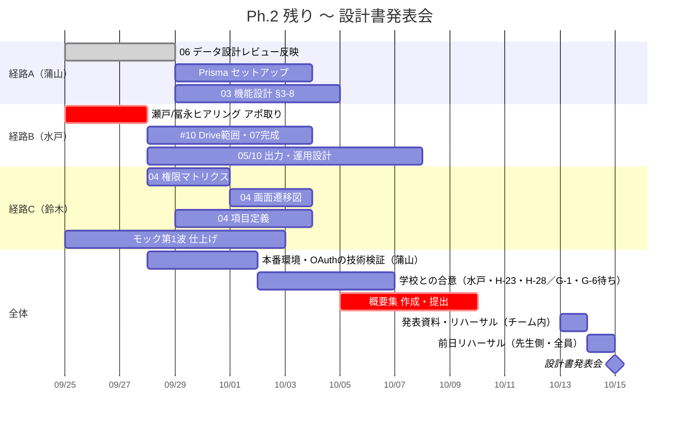

# WBS — Ph.2 残り 〜 設計書発表会（2026-10-15）、Ph.3（機能実装）

> **位置づけ**：いつ・誰が・何を・どの順でやるかに答える、確定した WBS 本体
> **確度**：確定（`pm/wbs-source.md`〔cc28f95時点・削除済み〕の一次資料をもとに鈴木が編成）
> **正典**：このファイル
> **更新のしかた**：上書き（実績が動くたびに §4 の状態列を直す）
> **主担当**：鈴木（PM2・スケジュール／タスク管理。企画書 §6-2）
> **最終更新**：2026-10-20（水戸）

**確定の範囲**（`AGENTS.md` 禁則7）：本ファイルが確定するのは、Ph.2残りの**構造（章の分解単位）・担当・期日**と、Ph.3の**構造**（§8。段の分解単位・順序・未決の扱い。Ph.3の期間・担当・見積りは含まない）。§4の状態列は、作成時点の実態の写しであり、更新のしかたのとおり上書きで直す（確定しているのは「この形式で管理する」ことであって、個々の状態値の正しさを毎回保証するものではない）。

`docs/open-questions.md` P-1（実装優先順を着手順序へ翻訳する作業が未登録だった件）の決着として作成した。**依存の順序は `requirements.md` §1-2 で確定済み**（基盤→背骨→後段）。ここではそれを日程・担当へ翻訳する。**§1〜§7 の対象はPh.2残り。Ph.3（機能実装）は §8 で、構造（段の分解単位・順序・未決の扱い）だけを確定し、期間・担当・見積りは06データ設計のレビュー完了後に足す**（P-1のPh.3分として`open-questions.md`に残す）。

**Ph.2 の残りは作業単位（Lv.3）まで割る**（`pm/wbs-source.md`〔cc28f95時点・削除済み〕§3-1 の推奨を採用）。Ph.3 は機能単位（`requirements.md` §3 の節）まで割る（§8-3）。作業単位への分解は、06データ設計のレビュー後に P-1（`docs/open-questions.md`）で行う。Ph.4 以降の粒度は未定。

見積りは人日ではなく「**1〜2週で終わる単位に割れているか**」で置く（`pm/wbs-source.md`〔cc28f95時点・削除済み〕§8 D8 の推奨を採用）。学生プロジェクトで人日は精度が出ない。

---

## 1. 全体像（Lv.1）

| ID | フェーズ | 期間 | 状態 |
| --- | --- | --- | --- |
| 0 | Ph.0 企画・確認 | 06-19〜07-17 | **完了**（企画書発表会 07-17） |
| 1 | Ph.1 要件定義・基本設計 | 07-18〜08-20 | **未完了のまま Ph.2 に食い込んでいる** |
| 2 | Ph.2 詳細設計・開発基盤 | 08-21〜10-15 | **終了**（設計書発表会 10-15）。未了の設計書は Ph.3 へ繰り越す（§8-2） |
| 3 | Ph.3 機能実装 | 10-16〜11-26 | **進行中**。構造は §8。期間・担当は06データ設計のレビュー後。企画書 §6-1 の旧語彙は使わず、`requirements.md` §1-2 の依存順（基盤／背骨／後段）で組み直した。実働の最終日は 11-20（§8-1） |
| 4 | Ph.4 テスト・完成 | 11-27〜12-17 | 未着手 |
| 5 | Ph.5 発表準備 | 12-18〜02-09 | 未着手 |

**注記（卒業作品試作版発表会）**：第 3 回の発表会「卒業作品試作版発表会」は 12-17〜12-18 の 2 日にわたり、**Cheers の発表日は 12-18**（日程と発表日の出典は `docs/hearing.md` §14）。12-18 は Ph.5 の初日に当たる。フェーズの区切りは上の表のとおり。

- 役割：プレゼン＝蒲山・質疑応答＝水戸・実機デモ＝未決（**担当は 12-11 までに決める**。発表日の 1 週間前）
- この注記は Ph.2 の外の事項で、冒頭の確定の範囲（Ph.2 残りの構造・担当・期日）には入らない。§4 の台帳の対象外

---

## 2. 前提となる制約

**稼働体制は 9/22 から 3 倍になっている。** これ以前（週1日・金曜6時間のみ）と、これ以降（月4h・火4h・木4h・金6h＝週18h）で意味が変わるため、企画書 §6-1 の「週」をそのまま使わない。ガントは日付そのもので引く。

| ブロック | 日程 | 時間 | 備考 |
| --- | --- | --- | --- |
| B1 | 09-22・09-24・09-25 | 14h | 09-25 が最終日（終了） |
| B2 | 09-28・09-29・10-01・10-02 | 18h | |
| B3 | 10-05・10-06・10-08・10-09 | 18h | 概要集の提出期限（`docs/hearing.md` §11） |
| B4 | 10-13 | 4h | 最終稼働日 |
| — | 10-14 | — | 先生側の前日リハーサル（全員：4.6.9） |
| — | 10-15 | — | **★ 設計書発表会本番（発表：鈴木）** |

**チーム3名が同時に動ける時間はこの日程がすべて。** 個別の曜日・稼働内訳は次のとおり（`pm/wbs-source.md`〔cc28f95時点・削除済み〕§2-3-1より移設）。

| 日付 | 曜 | 稼働 | 備考 |
| --- | --- | --- | --- |
| 09-11 | 金 | 0h | プレゼン2本の準備日。鈴木＝WBSを組む／水戸・蒲山＝サポート |
| 09-14〜09-17 | 月〜木 | 0h | 旧体制（週1・金のみ） |
| 09-18 | 金 | 0h | ★ プレゼン2本とも本番（実践ゼミ／開発実習）。両方とも発表は鈴木 |
| 09-21 | 月 | 0h | 敬老の日 |
| 09-22 | 火 | 4h | 新体制の初日／実質の再始動日 |
| 09-24 | 木 | 4h | |
| 09-25 | 金 | 6h | |
| 09-28 | 月 | 4h | |
| 09-29 | 火 | 4h | |
| 10-01 | 木 | 4h | |
| 10-02 | 金 | 6h | |
| 10-05 | 月 | 4h | |
| 10-06 | 火 | 4h | |
| 10-08 | 木 | 4h | |
| 10-09 | 金 | 6h | 概要集の提出期限（`docs/hearing.md` §11） |
| 10-12 | 月 | 0h | スポーツの日 |
| 10-13 | 火 | 4h | 最終稼働日 |
| 10-14 | 水 | 0h | 先生側の前日リハーサル（日と参加する人は `docs/hearing.md` §13-2・4.6.9）。発表資料の提出期限（`docs/hearing.md` §11）。チームの稼働日ではない（提出は 10-13 に済ませる：4.6.7） |
| 10-15 | 木 | — | ★ 設計書発表会 本番 |

**正味54時間。** 実質の再始動は9/22（火）、最終稼働日は10/13（火）。**9/11〜9/21の11日間はチーム稼働ゼロ。** この間に動けるのは水戸だけ。

---

## 3. クリティカルパス — 3本の根

障害ゼロで着手でき、完了すると下流が開く作業は3本。**2026-10-11 時点、A・C は完了し、下流（Prisma・04項目定義・09認可判定）が開いている。B は 10/2 に冨永先生・瀬戸先生と対面済み。フォームの回答は、瀬戸先生の分が 2026-10-06 に届き、冨永先生の分も届いている。`docs/hearing.md` に記録したのは、瀬戸先生の分は §12（段階①の置き場所・名前・証明書）だけ、冨永先生の分は §15 で（10/22 の対面の聞き取りは §16）、下の #10・G-1 に関わる瀬戸先生の回答は、記録するまで決着として扱わない（H-19 はフォームで伺っていない：§4-2）。**

```
【経路A】蒲山 — 06 データ設計（ER図・テーブル定義）
  状態：完了（PR #23・2026-09-29マージ済み。確度は暫定〔レビュー未了〕のまま）
    ├→ Prisma セットアップ（4.4.2）
    ├→ 03 機能設計 §3-8（水戸）
    ├→ 04 項目定義（鈴木）
    └→ 09 認可の文脈判定（水戸）→ Ph.3 実装のほぼ全部

【経路B】水戸 — 瀬戸先生／冨永先生ヒアリングのアポ取り
  状態：10/2（金）に冨永先生・瀬戸先生と対面済み。伺えなかった点はフォームで送り、回答は瀬戸先生の分が 2026-10-06 に届き、冨永先生の分も届いている。`docs/hearing.md` に記録したのは、瀬戸先生の分は §12 だけ、冨永先生の分は §15 で、下の #10・G-1 に関わる瀬戸先生の回答は、記録するまで決着として扱わない（H-19 はフォームで伺っていない）。今後の窓口は冨永先生（出典：Issue #52）
    ├→ #10 Drive統合の範囲確定 → 07 外部IF設計
    ├→ 概要フォーム現物 → 05 出力設計（H-8 は 2026-10-22 に決着：`docs/decisions.md`）
    ├→ H-19 → 10 運用設計
    └→ G-1 運用体制 → 10 運用設計

【経路C】鈴木 — 04 画面設計レビュー完了
  状態：完了（2026-09-18・確度「確定」）
    └→ 04 画面遷移図・権限マトリクスが着手可能になった
```

**07 外部IF設計（PR #25・2026-09-28マージ済み）・09 非機能 9-4 追記（PR #27・2026-10-01マージ済み）は、経路Bの決着を待たずに書ける範囲まで先に進めてマージ済み。** 経路Bが空いた時点でこれらを完成させる。

---

## 4. タスク台帳（Ph.2 残り・Lv.3）

状態の記法：**済**＝完了／**レビュー中**＝草稿提出済みでPR審査中／**可**＝着手可能（障害なし）／**待**＝依存待ち／**未**＝着手条件が未整理

### 4-1. 基本設計書（`docs/design/` 全10章）

| ID | 章 | 状態 | 担当 | 残作業 | ブロック |
| --- | --- | --- | --- | --- | --- |
| 4.1.1 | 01 システム概要 | **済** | 水戸 | — | — |
| 4.1.2 | 02 業務設計 | **済** | 水戸 | — | — |
| 4.1.3 | 03 機能設計 | 待 | 水戸 | §3-6・§3-8のTODO解消。06は完了済み（PR #23） | B2〜B3 |
| 4.1.4a | 04 画面設計レビュー | **済**（09-18） | 鈴木 | — | — |
| 4.1.4b | 04 権限マトリクス | **済**（PR #39・10-03マージ） | 鈴木 | — | — |
| 4.1.4c | 04 画面遷移図 | **済**（PR #62） | 鈴木 | — | — |
| 4.1.4d | 04 項目定義 | **可** | 鈴木 | 06完了済み（PR #23）で着手可能になった。未着手 | B3 |
| 4.1.5 | 05 出力設計（5-4以外） | 待 | 水戸 | 概要フォーム現物待ち。H-7/H-8 は決着（`docs/decisions.md` 2026-10-22）し、5-5 は書ける | B2〜B3 |
| 4.1.6 | 06 データ設計 | **済**（PR #23・09-29マージ） | 蒲山 | 確度は暫定（レビュー未了）。「済」は作成済みの意味 | — |
| 4.1.7 | 07 外部IF設計 | **済**（PR #25・09-28マージ） | 蒲山 | 確度は暫定（レビュー未了）。完成には経路B（#10）が要る | B2 |
| 4.1.8 | 08 8-7 デプロイ構成 | **済**（PR #57・10-05マージで 8-7-1〜8-7-4、PR #77・10-09マージで 8-7-1〜8-7-6 を段階①〔学内〕既定にそろえた） | 蒲山 | ①のどのサーバーか（H-28 (c)）と、名前・証明書（H-23 (d) の学校側。取り方の候補は`docs/decisions.md` 2026-10-08の(1)〜(3)）が決まったら、条件つきで書いた箇所を直す（`docs/design/08-architecture.md` 8-7-1 の「決着したときに変わる箇所」）。②（インターネット経由）のホスティング先と請求先はG-1・G-6待ち | B3 |
| 4.1.9a | 09 9-1 性能 | 待 | 水戸 | ポーリング間隔・概要集生成目標値（保留中） | B3 |
| 4.1.9b | 09 9-2 可用性・バックアップ | 待 | 水戸＋蒲山 | G-2要件補充待ち | B3 |
| 4.1.9c | 09 9-3 認証方式 | 待 | 水戸 | 4.4.3（OAuthの本番投入の可否）待ち。一次検証はF-04で済み | B3 |
| 4.1.9d | 09 9-4 認可（文脈判定追記） | **済**（PR #27・10-01マージ） | 蒲山 | 確度は暫定（レビュー未了）。「済」は作成済みの意味 | — |
| 4.1.9e | 09 9-6 ログ・監査証跡 | 待 | 水戸 | G-5要件補充待ち | B3 |
| 4.1.10a | 10 10-2 初期データ投入方針 | **可** | 水戸 | 未着手。方針は書ける（H-11決着済み） | B2 |
| 4.1.10b | 10 10-5・10-6 運用・引き継ぎ | 待 | 水戸 | G-1要件補充待ち | B3 |
| 4.1.10c | 10 10-7 リハーサル確認運用 | 待 | 水戸 | H-19（経路B）待ち | B3 |

### 4-2. 未決事項がWBSに与える影響

**未決事項そのものの一覧は`docs/open-questions.md`を参照（転記しない・禁則2）。** ここには、その未決が**どのタスクを止めているか**・**いつまでに決着が要るか**だけを置く。

| 未決 | 止めているタスク | 決着の期限・経路 |
| --- | --- | --- |
| #10（Drive統合の範囲） | 4.1.7（07外部IF設計） | 経路B（瀬戸先生へ送ったフォームの回答）は 2026-10-06 に届いた。#10 に関わる回答があれば `docs/hearing.md` に記録する（水戸。§12 に記録したのは段階①の分だけ）。記録するまで決着として扱わない |
| #8（先生ロール二層） | 4.1.9d（09認可）・4.1.10c | チーム合意（先行方針＝単層で先行中） |
| T-2（コメント編集・削除） | モック第1波のSC-12 | モックで描くか否かで決着を迫る（鈴木＋水戸） |
| H-4（検索の単位） | モック第1波のSC-15〜17 | **決着**（`docs/decisions.md` 2026-10-20 の H-4 の行） |
| H-7・H-8（概要集の陳腐化） | 4.1.5（05出力設計） | **決着**（`docs/decisions.md` 2026-10-22 の H-7・H-8 の行。材料は `docs/hearing.md` §15・§16） |
| H-19（リハーサル確認運用） | 4.1.10c | 経路B。ただし 10/2 の対面の議題にも、送ったフォームの設問にも入っていない（どこで伺うかは未定） |
| #7（テンプレート）・T-3（使用技術欄） | 4.1.3（03機能設計）・4.1.6 | #7 は先行方針で先行中（期限なし）。T-3 は**決着**（`docs/decisions.md` 2026-10-22 の T-3 の行） |
| G-1・G-2・G-5（運用・可用性・ログ） | 4.1.8・4.1.10b・4.1.9e | ヒヤリング＋技術方式待ち（水戸＋蒲山） |
| H-23・H-28（段階①の成立条件：置き場所・名前・証明書） | 4.1.8・4.4.4c | 経路B（フォームの回答）は 2026-10-06 に届いたが、どのサーバーか・名前・証明書は決まらず、次の期限は未定（`docs/hearing.md` §12）。そろわなかったときの扱いは 2026-10-08 に決めた（`docs/decisions.md` 2026-10-08：①を既定のまま維持し、8-7 は条件つきで書く） |
| G-6（学外へのデータ設置の学内ポリシー適否） | 4.1.8・4.4.4c（どちらも段階②の部分。段階①では対象外：`docs/open-questions.md` G-6） | 瀬戸先生への確認待ち（水戸） |

### 4-3. ステークホルダー対応（リードタイムを持つ唯一の作業）

| 相手 | 回収するもの | 状態 |
| --- | --- | --- |
| **瀬戸先生**（Drive/Workspace管理権限者） | #10の承認・G-1・G-6（学外へのデータ設置）のシステム管理と費用 | 10/2（金）に対面済み。伺えなかった点はフォームで送付し、**回答は 2026-10-06 に届いた**。`docs/hearing.md` に記録したのは段階①の置き場所・名前・証明書（§12）だけで、#10・G-1・G-6 に関わる回答があれば記録する（水戸）。記録するまで決着として扱わない。窓口は冨永先生（出典：Issue #52） |
| **冨永先生**（運営実務担当） | 概要フォーム現物・H-8・発表1コマの所要時間（設計書発表会の分は `docs/hearing.md` §11）・H-19（10/2 の対面・フォームでは未聴取）・G-5・チーム数 | 10/2 に対面済み。**冨永先生のフォームの回答も届き、`docs/hearing.md` §15 に記録した**（水戸）。H-8 に関わる点は 10/22 に対面で伺い、§16 に記録して決着した（`docs/decisions.md` 2026-10-22）。**今後のご相談の窓口**で、瀬戸先生や担当の先生へも引き継いでもらう |

### 4-4. 開発基盤

| ID | 作業 | 状態 | 担当 |
| --- | --- | --- | --- |
| 4.4.1 | Docker（PostgreSQLのみ） | **済** | 蒲山 |
| 4.4.2 | Prismaセットアップ・マイグレーション | **済**（PR #41・#45マージ済み） | 蒲山 |
| 4.4.3 | Auth.js × 学校GoogleアカウントOAuthの技術検証 | 一次検証済み（F-04・9/11）／本番投入の可否は未了 | 蒲山（技術検証） |
| 4.4.4a | 本番環境の技術検証：H-23 (a)(d)・H-28 (b) | 10/2 までの分は済（`docs/findings.md` F-04・F-07・F-11）。残りは `docs/open-questions.md` H-23・H-28 の期限欄 | 蒲山（技術検証） |
| 4.4.4b | H-28 (c) 本番サーバー設置場所の回答者の特定 | 窓口（冨永先生）までは特定済み（10/2 対面・Issue #52）。担当の方は未特定 | 水戸 |
| 4.4.4c | 本番環境（ホスティング先・請求先）の学校との合意 | 段階①の置き場所・名前・証明書はH-23・H-28待ち（経路B）。段階②はG-1・G-6待ち（経路B） | 水戸 |
| 4.4.5 | PDF生成手段の技術検証 | **済** | 蒲山 |

### 4-5. モック画面（20画面）

**`04-screen.md` §6 の3波。D10決定（`docs/decisions.md` 2026-09-27の行。出所は`pm/wbs-source.md`〔cc28f95時点・削除済み〕§8）により、第2波・第3波は10/15のスコープから外し、Ph.3へ送る。**

| ID | 対象 | 状態 |
| --- | --- | --- |
| 4.5.0 | `feature/mock`を`main`へマージ | 済（PR #94） |
| 4.5.1 | 第1波：SC-01,02,03,04,06,09,12,13,14（9画面） | 進行中（視覚改善中） |
| 4.5.2 | 第2波・第3波（残り11画面） | **10/15スコープ外（Ph.3送り）** |

**10/15 に向けた 4.5.1 の到達点は、デモ動画（4.6.8）に映す画面が撮れる状態まで。** デモはその場で動かさず、撮った動画に合わせて発表者（鈴木）が説明するため。

### 4-6. 提出層・発表準備

| ID | 作業 | 期限 | 担当 |
| --- | --- | --- | --- |
| 4.6.1 | 提出層の作成（学校提出用設計書） | 置かない（`docs/decisions.md` 2026-10-08。作る時期は `docs/design/00-conventions.md` §1） | 水戸 |
| 4.6.5 | 概要集の作成（前回の概要集を直し、1 ページにまとめる。要件は `docs/hearing.md` §11） | 10-09（B3 の最終日）まで | 水戸 |
| 4.6.6 | 概要集の提出（クラスの概要集フォルダへコピーをアップロードし、原本をチームの Google ドライブ（提出先の共有ドライブとは別の、チームで持つフォルダ）に残す。提出場所・ファイル名の規則は `docs/hearing.md` §11） | 10-09 | 水戸 |
| 4.6.8 | デモ動画の撮影（モック第1波〔4.5.1〕の画面を撮る。音は入れず、発表では鈴木が動画に合わせて説明する。Meet 上での再生はリハーサル〔4.6.3〕で確かめる：`docs/hearing.md` §11） | 10-09（B3 の最終日）まで | 鈴木 |
| 4.6.2 | 発表資料の作成（発表時間は `docs/hearing.md` §11） | B4まで | 鈴木＋水戸 |
| 4.6.3 | リハーサル（チーム内。先生側の前日リハーサル〔4.6.9〕とは別） | B4 | 全員 |
| 4.6.7 | 発表資料の提出（クラスの発表資料フォルダへコピーをアップロードし、原本をチームの Google ドライブ（提出先の共有ドライブとは別の、チームで持つフォルダ）に残す。リハーサル〔4.6.3〕のあと、最終版（デモ動画〔4.6.8〕を含む）を鈴木から受け取って行う。提出場所・ファイル名の規則は `docs/hearing.md` §11） | 10-13（B4。§11 の期限より前倒し：§2 の 10-14 の行） | 水戸 |
| 4.6.9 | 前日リハーサル（先生側。日と参加する人は `docs/hearing.md` §13-2。チーム内のリハーサル〔4.6.3〕とは別） | 10-14 | 全員 |
| 4.6.4 | 発表本番 | 10-15 | **鈴木** |

ID は既存の 4.6.1〜4.6.4 を変えないために追番（4.6.5〜）とし、行は期限の順に並べた（期限を置かない 4.6.1 は先頭のまま）。

---

## 5. スケジュール（ガント）



---

## 6. WBS編成にあたって決めたこと

`pm/wbs-source.md`〔cc28f95時点・削除済み〕§8 で鈴木の判断とされていた項目のうち、本WBSで採用したもの。

| # | 論点 | 採用 |
| --- | --- | --- |
| D1 | WBSの粒度 | **Ph.2残りは作業単位まで割る**（Ph.3は機能単位まで〔§8-3〕。作業単位への分解はP-1で決める） |
| D8 | 見積りの置き方 | **(c) 「週内に収まるか」の粒度**。人日は置かない |
| D4 | 役割分担の見せ方 | 稼働の制約として見せる（`docs/decisions.md` 2026-09-27の行・水戸決定。§2参照） |
| D10 | モック第2波・3波の扱い | 10/15スコープから外しPh.3へ送る（`docs/decisions.md` 2026-09-27の行・水戸決定。§4-5参照） |

**D9（実践ゼミの持ち時間・提出形式）は未回答のまま。** 日程（9/18本番）は確定済みだが、詳細が分かり次第この節を更新する。

---

## 7. リスク

- **経路B（ヒヤリング）は 10/2 に対面済みで、フォームの回答も届いた（瀬戸先生の分は 2026-10-06。冨永先生の分も届いている）が、`docs/hearing.md` に記録した回答は、瀬戸先生の分のうち段階①の分（§12）と、冨永先生の分（§15）。** #10・05・10の3系統がここに乗っており、回答の記録が遅れると影響が最も広い
- **06データ設計は暫定（レビュー未了）のまま main に入っている**（PR #23）。レビューで構造が変わると、Prisma（4.4.2）・03・04項目定義・09認可判定に手戻りが及ぶ
- **モックと本実装の併存。** `feature/mock`は`main`へ統合済み（4.5.0）。`main`のルート`layout.tsx`がモックの`SessionProvider`／`AuthGuard`で全画面を包み、Auth.js（`src/auth.ts`）と並ぶ。Ph.3で同じURLの画面を1枚ずつ本実装へ置き換えるのか、モックを別の場所へ退避するのかは未決（#94の水戸レビューQ-1。`P-1`のPh.3分と合わせて決める）

---

## 8. Ph.3（機能実装）の WBS

> **この節が確定するのは Ph.3 の構造（段の分解単位・順序・未決の扱い）だけ。期間・担当・見積りは置かない。** `docs/open-questions.md` P-1 は、06 データ設計のレビュー完了までは見積りを行わないとしており、06 は 4.1.6 のとおり暫定のため。足すときは、確定の範囲を広げる変更として改めて PR にする。構造の確定は `docs/decisions.md` 2026-10-16 の行。
> **P-1 はこの節では閉じない。** Ph.3 の期間・担当が 8-3 に入ってから閉じる（`docs/open-questions.md` P-1 の閉じ方）。

依存の順序は `requirements.md` §1-2 のとおり（基盤 → 背骨 → 後段）。後段の中の 3-9 コメントと 3-7 アーカイブ検索の前後は §1-2 に定めがなく、**コメントを先、検索を後**とする（コメントは試作版発表会で使う想定で〔12/18 に本実装で作る範囲は Issue #98 で未決〕、検索は年度アーカイブのあとに使うため。鈴木の案に蒲山が賛成した：PR #93 のレビュー、2026-10-16。`docs/decisions.md` 2026-10-16 の行に入れた）。

### 8-1. ゴールと稼働

**ゴール：卒業作品試作版発表会で、同じクラス（IG21）の発表を YSE Compass 上で行う**（Issue #98）。発表会は 12/17 から複数日にわたり、Cheers の発表日は **12/18**。モックではなく本実装の範囲（サインイン・提出・閲覧など）が要る。**どこまで作るかは Issue #98 で決める（未決）。** 実機デモの担当は 12/11 までに決める（同 Issue）。Ph.4 の区切りの扱いは本節では決めない（同 Issue で水戸が別に決めるとしている）。

稼働は §2 の体制（月4h・火4h・木4h・金6h）が続く（鈴木確認 2026-10-16）。祝日は休み。10/30（金）は校内のスピーチコンテスト、11/23〜11/27 は学校が休みのため、作業はない。**10/16（金）は集計に含めない。**

| 週 | 稼働日 | 時間 | 備考 |
| --- | --- | --- | --- |
| 10/19〜10/23 | 月・火・木・金 | 18h | 10/19・10/20 に 06 データ設計のレビュー（8-4）。10/22 は予備日 |
| 10/26〜10/30 | 月・火・木 | 12h | 10/30（金）は休み |
| 11/02〜11/06 | 月・木・金 | 14h | 11/03（火）は祝日 |
| 11/09〜11/13 | 月・火・木・金 | 18h | |
| 11/16〜11/20 | 月・火・木・金 | 18h | **実働の最終週。** 企画書の Ph.3 の終わり（11/26）までは届かない |
| 11/23〜11/27 | なし | 0h | 学校が休み |
| **計** | | **80h** | |

### 8-2. Ph.2 からの繰越

**§4-1（基本設計書）と §4-4（開発基盤）のうち未了のもの〔「済」でも残作業が書かれている 4.1.7・4.1.8 を含む〕と、モック第 2・3 波（4.5.2）を Ph.3 に繰り越す。** §4-6 の発表準備は 10/15 で終わっており、繰り越さない。状態と担当は §4 の各行を正とし、ここには写さない（禁則2）。主なもの：

| §4 の ID | 繰り越すもの | 何を待っているか |
| --- | --- | --- |
| 4.1.3 | 03 機能設計（§3-6・§3-8 の TODO） | 3.1.1・3.1.2 の前提 |
| 4.1.4d | 04 項目定義 | 06 は完了済みで着手は可。06 のレビュー（8-4）で構造が変わると手戻り |
| 4.1.5・4.1.7・4.1.8 | 05 出力設計／07 の完成／08 の 8-7 の条件つき箇所 | 経路 B の回答の記録（§4-2・§4-3） |
| 4.1.9a・4.1.9b・4.1.9c・4.1.9e | 09 の 9-1・9-2・9-3・9-6 | §4-1 のブロック欄のとおり |
| 4.1.10a・4.1.10b・4.1.10c | 10 の 10-2・10-5・10-6・10-7 | §4-1 のブロック欄のとおり |
| 4.4.3・4.4.4a〜4.4.4c | OAuth の本番投入の可否／本番環境 | H-23・H-28・H-38（8-5） |
| 4.5.2 | モック第 2・3 波（11 画面） | 8-3 の対応する段の直前に起こす |

### 8-3. 段ごとのタスク台帳

状態の記法は §4 と同じ。**担当（主導／補佐）と期間は、06 のレビュー後に足す。** 「未決の上で組む形」は禁則5 のとおりで、各未決の先行方針は `docs/open-questions.md` の各項の先行方針欄が正（ここには写さない）。

| ID | 対象（`requirements.md` §3） | 前提 | 未決の上で組む形 | 担当 | 期間 | 状態 |
| --- | --- | --- | --- | --- | --- | --- |
| 3.0 | モックの `main` 統合（4.5.0） | — | — | — | — | **済**（PR #94） |
| 3.1.1 | 3-6 ログイン・ロール管理 | 06 のレビュー。4.4.3（OAuth）。4.1.3（03 の §3-6） | 認証はフォールバックで先行する（H-38 の先行方針で組む）。H-26（先生の事前登録）・H-32（利用者の同一性）・#8（先生ロール二層）・H-30（ロール変更の反映）・H-31（生徒の行の生成）は各項の先行方針で組む。先行方針がない未決：H-51（SC-20）（8-5） | 06 後 | 06 後 | 未 |
| 3.1.2 | 3-8 チーム・メンバー管理 | 3.1.1。4.1.3（03 の §3-8） | H-29 は決着済み（メンバー行＋引き換え）。H-40（チーム作成の入力）・H-41（メンバーの削除・移動）・H-43（作品名の入力者）・H-46（チームのクラスの出どころ）・H-54（「当年度」の定義）・H-55（アーカイブ済み年度の編集）・H-56（氏名・チーム名の入力の制約）は各項の先行方針で組む（クラスの作成は 3.1.2 に入れない：`open-questions.md` §7 の H-46 の行）。**引き換えの部分は実装しない**（H-25〔引き換えの UI 配置〕・H-42〔引き換えの自動照合の一致の定義〕が先行しない：`open-questions.md` §7） | 06 後 | 06 後 | 未 |
| 3.2.1 | 3-1 発表会・資料枠 | 3.1 | H-27（締切が空の扱い）・#7（テンプレート）・H-33（SC-04 のアクセス制限の区分。3.3.2 にも効く）は各項の先行方針で組む。H-39 は決着（`docs/decisions.md` 2026-10-20）。先行方針がない未決：H-44・H-51（8-5） | 06 後 | 06 後 | 未 |
| 3.2.2 | 3-4 提出・差し替え | 3.2.1 | #10（Drive 統合）が未決の間は**リンク登録**（Stage 1）で組む。H-19（リハーサルの確認運用）は先行方針で組む。H-39 は決着（`docs/decisions.md` 2026-10-20） | 06 後 | 06 後 | 未 |
| 3.2.3 | 3-2 提出状況一覧 | 3.2.2 | H-15（任意枠の未提出）は先行方針で組む。H-39 は決着（`docs/decisions.md` 2026-10-20） | 06 後 | 06 後 | 未 |
| 3.2.4 | 3-5 発表資料閲覧 | 3.2.2 | H-49（作品の説明）は先行方針で組む。H-45 は決着（`docs/decisions.md` 2026-10-20）。先行方針がない未決：H-51（8-5） | 06 後 | 06 後 | 未 |
| 3.3.1 | 3-10 当日タイムテーブル | 3.2 | H-20（発表の時刻枠）は発表順のみで組み、ポーリング間隔（保留）は暫定の間隔で組む（各項の先行方針）。**3-3 と同時かそれ以前**（`requirements.md` §1-2）。H-39 は決着（`docs/decisions.md` 2026-10-20）。先行方針がない未決：H-47・H-48・H-51（8-5） | 06 後 | 06 後 | 未 |
| 3.3.2 | 3-3 資料公開・配信（概要集の PDF） | 3.3.1（発表順が概要集の並び順の源） | H-37 は 1 通りのフォームで組む。概要の画像は、置き場所（H-52）と枠の仕様（H-53）が先行しないため組まない（`open-questions.md` §7）。H-7・H-8（概要集の生成タイミングと陳腐化）は先行方針で組む（`open-questions.md` §7。決着は、冨永先生のフォームの回答を `hearing.md` に記録した後で、回答は §15 に記録した）。H-45 は決着（`docs/decisions.md` 2026-10-20）。**先行方針がない未決：H-47・H-50・H-51**（8-5）。着手前に決める | 06 後 | 06 後 | 未 |
| 3.3.3 | 3-9 コメント | 3.2.4 | T-2（編集・削除）は決着を待つ。`open-questions.md` §7 の先行方針は「モックで『…』メニューを描くか否かで決着を迫る」で、組む形ではない。06 の暫定は「投稿は消えない」前提（`06-data.md` 6-3 `comments` の注）。H-49（作品の説明）は先行方針で組む。先行方針がない未決：H-51（SC-12）（8-5） | 06 後 | 06 後 | 未 |
| 3.3.4 | 3-7 アーカイブ・検索 | 3.2（溜まった提出物） | H-36 は先行しない（資料枠に公開区分の列を足さない）。H-49（作品の説明）は先行方針で組む。H-4（検索の単位）・H-45 は決着（`docs/decisions.md` 2026-10-20）。T-3（使用技術欄の入力形式）は先行方針で組む（`open-questions.md` §7。決着は、冨永先生のフォームの回答を `hearing.md` に記録した後で、回答は §15 に記録した）。**先行方針がない未決：H-44・H-51**（8-5）。着手前に決める。T-3 は 06 が暫定で自由記述（text）として組んでいる | 06 後 | 06 後 | 未 |
| 3.4 | 統合・結合テスト | 3.1〜3.3 | — | 06 後 | 06 後 | 未 |

### 8-4. クリティカルパス

```
06 データ設計のレビュー（10/19・10/20。予備 10/22）
  └→ 指摘の反映 → Prisma スキーマ・マイグレーションの更新（初回分は 4.4.2 で済）
       └→ 3.1 基盤 → 3.2 背骨 → 12/18 のデモの範囲（8-1・Issue #98）

【並行】本番の名前と証明書（H-38。水戸・蒲山）
  └→ 学内・学外の構成でのサインインの確認（デモの前提）
```

06 のレビューは、10/19 に基盤・背骨が使うテーブル（利用者・チーム・メンバー・発表会・資料枠・提出・概要）を、10/20 に後段が使うテーブル（発表・コメント・いいね）と未決の先行方針の見直しを行う。レビューは鈴木と水戸、蒲山は説明と直し。**期間と見積りは、10/20 の終了後に 8-3 へ足す。**

### 8-5. 未決が止めるもの

未決そのものは `docs/open-questions.md` が正（ここには写さない）。ここには、止めるタスクと決める場所だけを置く。

| 未決 | 止めるもの | 決める場所 |
| --- | --- | --- |
| 12/18 に本実装で作る範囲 | 8-3 の期間と、どの段まで 12/18 に載せるか | Issue #98（水戸） |
| モックと本実装の併存（同じ URL の画面を 1 枚ずつ置き換えるか、モックを退避するか） | 3.1 の着手のしかた。§7 のリスク | P-1 の Ph.3 分（#94 の水戸レビュー Q-1。`docs/decisions.md` 2026-10-16 の行が、P-1 で決めるとした） |
| H-38（本番の名前と証明書、ドメイン） | 4.4.4c。デモ前のサインインの確認 | `open-questions.md` H-38（水戸・蒲山） |
| 06 の先行方針（H-20・H-26・H-27・H-32・T-2） | 3.1.1・3.2.1・3.3.1・3.3.3 の組み直し | 10/20 の見直し（8-4） |
| H-25（引き換えの UI 配置）・H-42（引き換えの自動照合の一致の定義） | 3.1.2 のうち引き換えの部分（チーム作成とメンバー入力は H-40 の先行方針で進められる） | `open-questions.md` 各項（H-25 は、モックで描くか否かで決着を迫る：§7） |
| **先行方針がない未決**（H-44・H-47・H-48・H-50・H-51） | 下の表のとおり | 各項。着手前に決めるか、`open-questions.md` §7 に先行方針を足す |
| H-7・H-8（概要集の生成と陳腐化）・T-3（使用技術欄） | 先行方針で組むため止めない。決着したときに 3.3.2・3.3.4 が変わる | `open-questions.md` 各項（水戸）。決着は、冨永先生のフォームの回答を `hearing.md` に記録した後で、回答は §15 に記録した |
| #10（Drive 統合） | 3.2.2 のリンク登録から先の形 | 経路 B（§4-3） |
| H-36・H-37（設計書発表会で出た宿題） | 先行しない／1 通りで組むため、止めない。決着したときに 3.2・3.3 が変わる | `open-questions.md` 各項（水戸） |
| H-52（概要の画像の置き場所）・H-53（概要の画像の枠の仕様） | 先行しないため止めない。決着したときに 3.3.2 が変わる | `open-questions.md` 各項 |

先行方針がない未決と、止めそうなタスク（各項の「効く先」から読んだ見立て）：

| 未決 | 止めそうなタスク（8-3） |
| --- | --- |
| H-44（発表会の時期と「終了」の判定） | 3.2.1・3.3.4 |
| H-47（先生の工程の順序） | 3.3.1・3.3.2 |
| H-48（当日の発表順の変更の画面） | 3.3.1 |
| H-50（概要集のファイル名） | 3.3.2 |
| H-51（04 とモックのずれ） | 3.1.1・3.2.1・3.2.4・3.3.1・3.3.2・3.3.3・3.3.4 |
